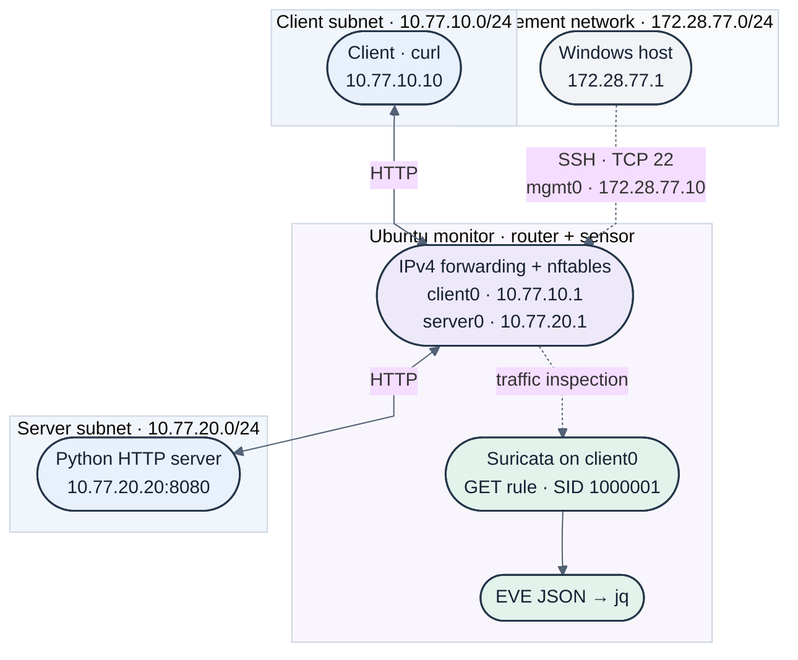

# CyberSOC Network Monitoring Lab

**Personal project, in progress (September 2026 to present)**

A three-VM lab for practicing network monitoring and detection. Client traffic crosses a Linux router that captures packets and runs Suricata, and I use it to write and test detection rules against traffic I generate myself.

## Objective

Build a small segmented network, capture HTTP traffic crossing it, and detect a specific request pattern with a custom Suricata rule. The aim is to understand the full path from routing and firewall configuration to packet capture, rule writing, alert generation and log inspection.

## Architecture

Three Ubuntu VMs run in VMware. The monitor sits between two subnets and routes traffic from one to the other.

| VM | Role | Address |
|---|---|---|
| Client | Generates HTTP requests | 10.77.10.10 |
| Monitor | Router and sensor, client side | 10.77.10.1 |
| Monitor | Router and sensor, server side | 10.77.20.1 |
| Server | Web server on port 8080 | 10.77.20.20 |

Client and server use separate subnets, `10.77.10.0/24` and `10.77.20.0/24`. HTTP requests between them pass through the monitor.

## Tools

VMware, Ubuntu, nftables, tcpdump, curl, Suricata 7.0.3 and jq.

## Completed Milestones

1. Built the three VMs with separate client and server subnets and addressed each interface.
2. Configured static routes and Linux IPv4 forwarding on the monitor, plus nftables rules.
3. Sent client-to-server HTTP traffic on port 8080 and captured it on the monitor.
4. Analyzed the capture offline with Suricata.
5. Wrote a custom HTTP GET detection rule (SID 1000001).
6. Validated the rule with GET and HEAD requests.
7. Ran Suricata for live detection and enabled it as a systemd service.
8. Rebooted and confirmed that live alerts still fired.
9. Inspected Suricata's EVE JSON event and alert records with jq.

## Detection Validation

I sent both a GET and a HEAD request from the client to the server. Suricata logged both as HTTP transactions, and the custom rule alerted on the GET request only. That confirms the rule matches the method it was written for and does not fire on a different HTTP method.

After enabling Suricata as a service and rebooting, I confirmed that live alerts were still generated.

## Evidence

- [Architecture and firewall policy](docs/architecture.md)
- [Mermaid diagram source](evidence/diagrams/network-topology.mmd)
- [Captioned lab screenshots](docs/screenshots.md)
- [GET/HEAD results, verification commands and evidence dates](docs/test-results.md)
- [Custom Suricata rule](configs/suricata/local.rules)
- [GET/HEAD packet capture](evidence/pcaps/get-head.pcap)
- [Selected HTTP and alert events](evidence/logs/get-head-events.jsonl)
- [Monitor service status](evidence/logs/suricata-status.txt)

The repository includes selected configuration exports and test artifacts. Selected setup screenshots are included; persistent per-VM configuration files will be added as they are collected.

## Limitations

- This is a small lab with traffic I generate myself, not a production SOC.
- There is no SIEM integration, centralized dashboard or incident response workflow.
- Detection covers one custom rule. The nftables setup is a lab configuration, not a hardened policy.

## Next Steps

- Export persistent per-VM network and Suricata service configuration.
- Extend detection coverage with additional positive and negative tests.
