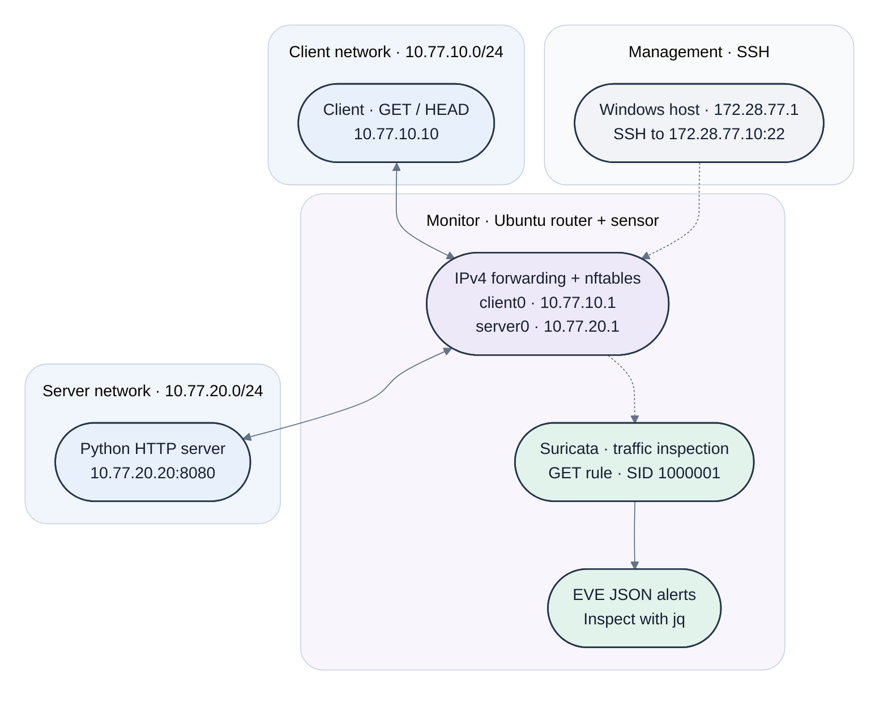

# CyberSOC Network Monitoring Lab

**Personal project, in progress (September 2026 to present)**

A three-VM lab for practicing network monitoring and detection. Client traffic crosses a Linux router that captures packets and runs Suricata, and I use it to write and test detection rules against traffic I generate myself.

## Objective

Build a small segmented network, capture HTTP traffic crossing it, and detect a specific request pattern with a custom Suricata rule. The aim is to understand the full path from routing and firewall configuration to packet capture, rule writing, alert generation and log inspection.

## Architecture

Three Ubuntu VMs run in VMware. The monitor sits between two subnets and routes traffic from one to the other.

**Reading the diagram:** The two-way arrows carry HTTP requests and responses. Dashed arrows show the separate management SSH connection and traffic inspection by Suricata on `client0`. The arrow from Suricata to EVE JSON represents log output.

| VM | Role | Address |
|---|---|---|
| Client | Generates HTTP requests | 10.77.10.10 |
| Monitor | Router and sensor, client side | 10.77.10.1 |
| Monitor | Router and sensor, server side | 10.77.20.1 |
| Server | Web server on port 8080 | 10.77.20.20 |

Client and server use separate subnets, `10.77.10.0/24` and `10.77.20.0/24`. HTTP requests between them pass through the monitor.

## Tools

VMware, Ubuntu, nftables, tcpdump, curl, Suricata 7.0.3 and jq.

## Completed Work

- **Network configuration:** Built three VMs, configured addressing and routes, and enabled IPv4 forwarding with nftables rules on the monitor.
- **Packet capture:** Generated HTTP traffic from the client to the server on port 8080 and captured it with tcpdump.
- **Detection testing:** Analyzed the capture offline with Suricata and validated custom rule SID 1000001 using GET and HEAD requests.
- **Live monitoring:** Enabled Suricata as a systemd service, confirmed alerts after reboot and inspected EVE JSON events with jq.

## Detection Validation

Both requests targeted `/` on the lab server:

| Request | HTTP response | Alerts for SID 1000001 |
|---|---|---|
| GET | 200 | 1 |
| HEAD | 200 | 0 |

The GET HTTP record and alert share the same flow ID. The HEAD transaction is logged without an alert for this rule. These two cases validate the expected behavior for the tested requests.

Suricata records the GET detection without blocking the request. Live alerts were also verified after enabling the service and rebooting the monitor. The exported GET/HEAD records come from the earlier offline test; dates and evidence details are recorded in [test results](docs/test-results.md).

## Evidence

- [Architecture and firewall policy](docs/architecture.md)
- [Mermaid diagram source](evidence/diagrams/network-topology.mmd)
- [Captioned lab screenshots](docs/screenshots.md)
- [GET/HEAD results, verification commands and evidence dates](docs/test-results.md)
- [Custom Suricata rule](configs/suricata/local.rules)
- [GET/HEAD packet capture](evidence/pcaps/get-head.pcap)
- [Selected HTTP and alert events](evidence/logs/get-head-events.jsonl)
- [Monitor service status](evidence/logs/suricata-status.txt)

The repository includes selected configuration exports and test artifacts. Selected setup screenshots are included; persistent per-VM configuration files will be added as they are collected.

## Current Scope

- Controlled HTTP traffic between the lab client and server, with one custom detection rule.
- Linux routing and nftables policy between the two subnets; Suricata operates as an alerting sensor.
- Selected configuration exports and test artifacts are included. Persistent per-VM settings and the full Suricata service configuration remain to be exported.

## Next Steps

- Export persistent per-VM network and Suricata service configuration.
- Extend detection coverage with additional positive and negative tests.

