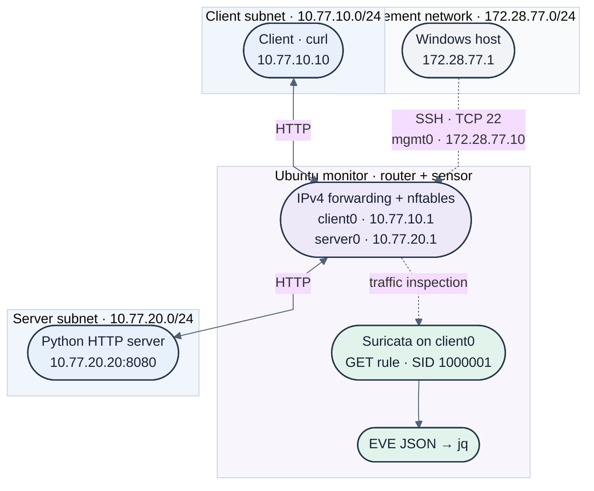

# Lab Architecture

Three Ubuntu VMs run in VMware. The monitor routes between separate client and server networks and inspects their traffic with Suricata.

| System/interface | Address | Purpose |
|---|---|---|
| Client | 10.77.10.10/24 | Generates test requests |
| Monitor: client0 | 10.77.10.1/24 | Client-side gateway and capture interface |
| Monitor: server0 | 10.77.20.1/24 | Server-side gateway |
| Server | 10.77.20.20/24 | Python HTTP server on port 8080 |
| Monitor: mgmt0 | 172.28.77.10/24 | Host management connection |
| Windows host management address | 172.28.77.1 | SSH access to the monitor |

The monitor's `update0` interface is down in the exported snapshot. Its main routing table contains connected routes for the three lab/management networks and no default route. IPv4 forwarding is enabled.

The solid links show the routed HTTP path. The dashed inspection link represents Suricata observing traffic on `client0`; requests do not pass through Suricata as a blocking proxy. The management SSH connection is separate from the HTTP test path.

## Firewall policy

The exported nftables ruleset uses default-drop input and forwarding chains and an accept output policy. It permits traffic between the client and server subnets in both directions, and permits management SSH from `172.28.77.1`, along with the other input exceptions shown in the ruleset.

The forwarding policy permits general traffic between those two subnets; it is not limited to HTTP port 8080. Segmentation provides a routing/inspection boundary, not isolation between the client and server.

## Configuration evidence

- [Monitor interfaces](../configs/network/monitor-interfaces.txt)
- [Monitor routes](../configs/network/monitor-routes.txt)
- [IPv4 forwarding](../configs/network/monitor-ip-forwarding.txt)
- [nftables ruleset](../configs/nftables/monitor-ruleset.nft)
- [Suricata rule](../configs/suricata/local.rules)

These files are observed configuration/state exports. The nftables file includes counters from collection time. Persistent per-VM network configuration and the Suricata YAML/service configuration have not yet been included, so this is not a complete automated rebuild bundle.
