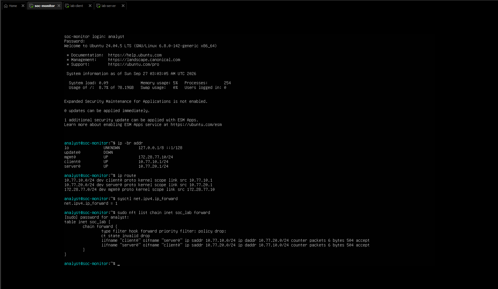
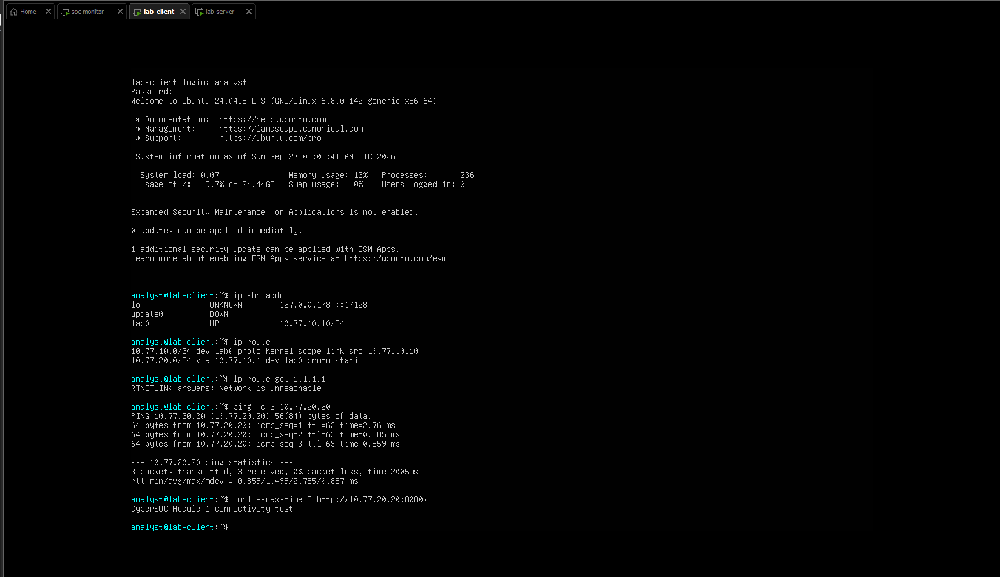
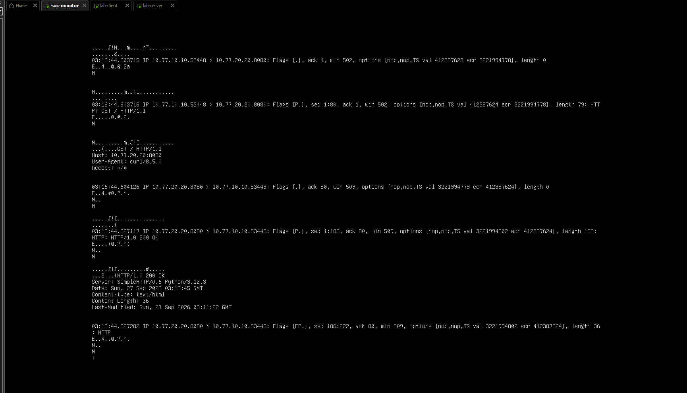
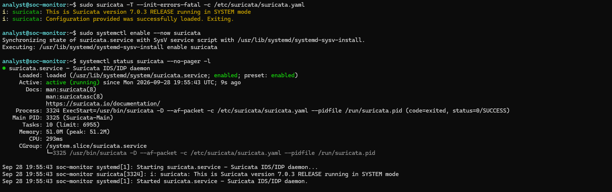

# Lab Screenshots

Selected screenshots from the original network setup and Suricata service configuration. These are supporting visual records from earlier lab sessions; the configuration exports and GET/HEAD capture were collected separately. See [test results](test-results.md) for dates and machine-readable detection evidence.

## Monitor network and forwarding

The monitor has separate client, server and management interfaces. IPv4 forwarding is enabled, and the nftables forwarding chain uses a default-drop policy with explicit allowances between the client and server subnets. The counters shown belong to this earlier session.

## Client connectivity and HTTP

The client has a route to the server subnet through `10.77.10.1`. The screenshot shows successful ping replies and an HTTP response from the lab server. The attempted route lookup for an external address reports no route in that snapshot.

## Captured HTTP exchange

The monitor capture shows a client GET request to `10.77.20.20:8080` and an HTTP 200 response. This is an earlier Module 1 capture, distinct from the GET/HEAD PCAP exported in this repository.

## Suricata configuration test and service

Suricata's configuration test succeeds, followed by an enabled and active systemd service. This screenshot documents configuration/service setup; use the [GET/HEAD event records](../evidence/logs/get-head-events.jsonl) and [test results](test-results.md) for detection outcomes.

